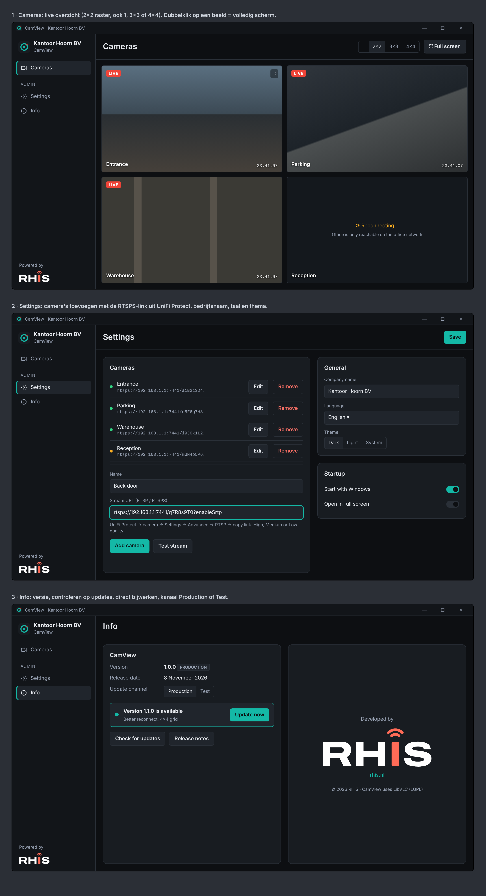

# CamView

Small Windows app to watch the live streams of UniFi Protect cameras (UDM Pro) via their RTSP(S) link, without a UniFi login. Made by [RHIS](https://rhis.nl).



## Features

- Live camera grid (1, 2×2, 3×3, 4×4) with paging, full screen per camera or for the whole grid (double-click, F11, Esc)
- Automatic reconnect when a stream drops (e.g. outside the office network)
- Settings: add, edit, reorder and test cameras; company name; language (English / Nederlands); dark, light or system theme; start with Windows; open in full screen
- Camera links are stored encrypted (Windows DPAPI) in `%AppData%\CamView\settings.json`
- Info: version, build channel, update channel (Production / Test), check for updates and update in-app
- Per-user MSI installer (no admin rights needed), installs to `%LocalAppData%\Programs\CamView`
- "Powered by RHIS" in the menu and on the Info page

## Getting a camera link

UniFi Protect → select camera → **Settings → Advanced → RTSP** → enable a quality (High / Medium / Low) → copy the `rtsps://…:7441/…?enableSrtp` link.

By default CamView plays such a link as `rtsp://…:7447/…` (same stream, unencrypted on the local network). This avoids problems with the self-signed certificate of the UDM Pro. Turn it off in Settings → Playback to use RTSPS.

## Branches, channels and updates

| Branch | Channel | Release |
| --- | --- | --- |
| `main` | Production | Normal GitHub release `v1.0.N` |
| `test` | Test | Pre-release `v1.0.N-test` |

GitHub Actions (`.github/workflows/build.yml`) builds every push and pull request on Windows and publishes the MSI as a release for `main` and `test`. The app reads the releases of this repository to find updates, downloads the MSI and installs it silently, then restarts.

> The update check uses the public GitHub API. **This repository has to be public** (or the releases mirrored to a public repository, see `AppInfo.UpdateRepository`) for the update check to work.

The version is `VERSION` (major.minor) plus the CI run number.

## Build locally (Windows)

Requires the .NET 8 SDK (`winget install Microsoft.DotNet.SDK.8`).

```powershell
.\build.ps1                      # dev build -> out\CamView-1.0.0.msi
dotnet run --project src/CamView # run without installer
```

## Tech

.NET 8 WPF, [LibVLCSharp](https://code.videolan.org/videolan/LibVLCSharp) (LGPL 2.1) for RTSP playback, WiX Toolset 5 for the MSI. House style: [`rhis-huisstijl/projecten/camview`](https://github.com/rhisijmuiden/rhis-huisstijl/tree/main/projecten/camview).

## Structure

```
src/CamView/
  App.xaml(.cs)          startup, LibVLC, theme + language
  MainWindow.xaml(.cs)   left menu, Powered by RHIS, full screen
  Views/                 CamerasView, CameraTile, SettingsView, InfoView
  Services/              settings, updates, theme, autostart, stream URL helpers
  Localization/          English + Dutch strings
  Themes/                CamView tokens (dark/light) and control styles
installer/               WiX package, license, installer images
```
